<h1 align="center">$ whoami >> root. always root</h1>

  <i>"According to your faith be it unto you."</i> — Matthew 9:29

  

  
  
  
  

---

## 👋 About Me

Hey, I'm William — a Software Engineering student at USP, Fiji 🇫🇯
- 💻 Into creative coding, computer vision & building random cool stuff
- 🌊 Tongan roots — might start a tech thing there one day
- 🛠️ Been messing with Python/ML, Flutter, MediaPipe & web dev
- 📌 "Obsession always wins"

---

## System Boot

  

---

## Now Playing

  

---

## Tech Stack

  

---

## Contribution Activity

  

  <picture>
    <source media="(prefers-color-scheme: dark)" srcset="https://raw.githubusercontent.com/W-SELUI/W-SELUI/output/pacman-contribution-graph-dark.svg" />
    <source media="(prefers-color-scheme: light)" srcset="https://raw.githubusercontent.com/W-SELUI/W-SELUI/output/pacman-contribution-graph.svg" />
    
  </picture>

  

